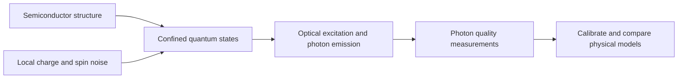
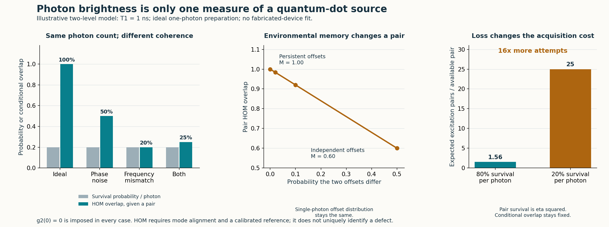

# Quantum dots: a bridge from semiconductors to photon quality

**Research extension, 11 November 2026.** A bounded quantum-optics benchmark and separately attributed experimental reference. This is not a fabricated device, a microscopic defect diagnosis, or a new quantum-advantage result.

A semiconductor can do more than switch current. Confinement can give its electrons and holes discrete quantum states; an optically active quantum dot can emit a photon when an excited state decays. The surrounding solid also introduces charge, spin and vibrational noise. That makes the dot a concrete meeting point for **semiconductor engineering, quantum-state dynamics and optical measurement**. Size-dependent confinement in semiconductor nanocrystals is explained in the [Nobel scientific background](https://www.nobelprize.org/uploads/2023/10/advanced-chemistryprize2023.pdf); composition, strain, barriers and electrical control also matter in epitaxial devices.



## Which kind of quantum dot?

| Platform | Physical role | Connection to this project |
|---|---|---|
| Optically active GaAs/InGaAs/InAs-family dots | A selected exciton or charged optical transition emits photons; some devices also host spin qubits | The closest match to our emitter, hidden environment and photon-detection models |
| Gate-defined silicon/SiGe dots | Electrostatic gates confine carriers; electron spin can encode a qubit | A separate semiconductor-computing direction with different control and measurement physics |
| Colloidal semiconductor nanocrystals | Confinement changes absorption and emission, with uses including displays | A useful introduction to confinement; an ensemble of fluorescent dots is not automatically a coherent single-photon or spin-qubit device |

These platforms should not be merged into one performance claim. [Gao et al.](https://www.nature.com/articles/nature11573) demonstrated a quantum-dot spin–photon entanglement interface. [Philips et al.](https://www.nature.com/articles/s41586-022-05117-x) demonstrated a six-spin-qubit silicon processor. Neither result is reproduced by the small model in this folder.

## A practical question: does bright light mean useful photons?

Photonic quantum circuits often need photons that match well enough to interfere. Counting photons alone does not measure all their optical-state information. Charge noise can shift a dot's transition, while other processes cause dephasing. [Kuhlmann et al.](https://arxiv.org/html/1301.6381v1) used quantum-dot resonance fluorescence to distinguish charge- and spin-noise signatures. This is established experimental work, not a capability newly established by our simulator.

| Measurement | What it can reveal | What it cannot establish alone |
|---|---|---|
| Photon count or brightness | Collected flux, blinking, loss and some excitation changes | Phase coherence or a unique cause of a change |
| Spectrum, linewidth and lifetime | Transition shifts, spectral broadening and population decay | The complete correlated noise dynamics |
| Hanbury Brown–Twiss correlation, `g2(0)` | Suppression or presence of multiple-photon emission | Whether photons emitted at different times occupy matching modes |
| Hong–Ou–Mandel (HOM) interference | Two photons' mode overlap under a calibrated interference measurement | Unique identification of a charge trap, laser drift or a semiconductor defect |

In an ideal HOM comparison, two matching single photons enter opposite ports of a balanced beamsplitter and leave together. More distinguishable photons produce more coincidences between its outputs. [Thoma et al.](https://arxiv.org/html/1507.05900v2) used varying photon separation and temperature to probe dephasing and memory in a semiconductor emitter. Their noise model and fitted parameters are different from our illustrative two-state environment.

This is a concrete version of the project's “another lens” idea: choose an additional measurement that sees a physically relevant property the existing record does not contain.

## Our bounded model

The [design record](PROTOCOL.md) fixes illustrative parameters before the benchmark run. One chosen dot transition is approximated as a two-level radiative emitter. It is ideally prepared once per pulse. This does **not** calculate a semiconductor band structure, predict emission wavelength from dot geometry, or include every exciton, spin, cavity and phonon process.

For radiative decay `Gamma = 1/T1`, pure coherence-decay rate `gamma_star`, and frequency offset `nu` in Hz, the normalized emitted-photon density kernel is

```text
rho(t,t') = Gamma exp[-Gamma(t+t')/2]
                  exp[-gamma_star |t-t'|]
                  exp[-i 2*pi*nu (t-t')],  t,t' >= 0.
```

For two photons with equal lifetime/dephasing and differential frequency `delta_nu`, independent fast dephasing gives the overlap

```text
M = Gamma (Gamma + 2*gamma_star)
    / [(Gamma + 2*gamma_star)^2 + (2*pi*delta_nu)^2].
```

With no differential detuning, `M = T2/(2*T1)` and `1/T2 = Gamma/2 + gamma_star`. This familiar Markov limit is not a universal formula for arbitrary colored noise. A shared frequency shift cancels: this measurement sees a difference, not an absolute optical frequency.

The model also compares two classical frequency offsets with persistent versus independently redrawn states. The switch probability describes a selected photon pair; no experimental delay or switching rate is inferred. It is **classical environmental memory**, not evidence for a coherent hidden defect qubit. An HMM is an appropriate baseline for such a model.

Equal brightness and ideal `g2(0)=0` are imposed by our one-photon preparation and frequency-independent loss. Real narrowband excitation, imperfect pulses, nonradiative decay, blinking and detector artifacts can change those statistics. Polarization and timing mismatch can also reduce HOM interference without the phase-noise mechanism modeled here.

## Executed benchmark

The [saved results](results.json) use `T1=1 ns` and `eta=0.2`, with illustrative parameters rather than a device calibration:

| Model case | gamma_star / Gamma | Differential angular detuning / Gamma | Photon overlap M | Two-output coincidences per excitation pair |
|---|---:|---:|---:|---:|
| Ideal reference | 0 | 0 | 1.00 | 0 |
| Phase noise | 0.5 | 0 | 0.50 | 0.010 |
| Frequency mismatch | 0 | 2 | 0.20 | 0.016 |
| Both | 0.5 | 2 | 0.25 | 0.015 |

Every case has the same per-photon survival probability, 0.2, and ideal photon-number `g2(0)=0`. Thus, in this model, the count and purity measurements alone cannot distinguish sources with very different interference quality. In the separate two-state comparison, keeping the same single-photon frequency distribution but changing the pair switch probability from 0 to 0.5 reduces overlap from **1.00 to 0.60**. A photon pair contains correlation information absent from its separate marginals.



Validation includes **16 model tests**, a direct bosonic creation-operator beamsplitter test, five density-kernel quadrature checks and a [separate adaptive-integration check](independent_review.json) that does not import the model implementation. Four settings also sample 100,000 independent excitation pairs each; this checks sampling/accounting, not a new physical hypothesis. The external reference has five additional format/checksum tests. These are local numerical/code checks, not independent laboratory replication.

## Costs and what a useful diagnosis would require

For equal independent survival/detection probability `eta` per photon, a pair is available with probability `eta^2`. The ideal coincidence probability per excitation pair is `eta^2*(1-M)/2`; the distinguishable reference gives `eta^2/2`. Conditional overlap by itself hides acquisition cost. Moving from `eta=0.8` to `0.2` requires **16 times as many attempts** for the same expected number of surviving pairs, before background, calibration and stability costs.

A useful device study would collect synchronized counts, HBT/HOM histograms, lifetime and spectral/reference measurements; vary laser detuning, polarization, excitation power and gate bias in controlled ways; then test predictions on unused records against classical models. Inferring a noise correlation is different from identifying its microscopic physical source.

The QRSM contributes a conditional physical model: predict how observations depend on the emitter and its hidden environment, and test candidate explanations. Additional optical measurements may constrain states that click counts cannot. Grover-style queries operate on a specified model and do not recover information that the detectors never acquired. This benchmark runs classically and provides no computational speedup.

## Existing real data and the next measured-data test

The repo already retains [external GaAs quantum-dot counts](../external_data/gaas_qd5/DATA_USE.md). They integrate photons for one second; every singles bin is nonzero. Converting those counts to bits loses the fine-time structure and cannot reconstruct photon interference.

The same authors separately released **co- and cross-polarized HOM histograms**. The [reference-data folder](reference_hom/README.md) imports those more suitable observables with source checksums and attribution. They remain an external experiment, not FGCU measurements or a fit of our model. The published three-delay result is approximately flat; it should not be presented as confirmation of a monotonic memory-decay prediction.

The next data task is to reproduce the authors' visibility extraction with its peak windows, beamsplitter/polarization corrections and uncertainties, then evaluate competing noise models. Raw peak heights alone are insufficient when acquisition scale and calibration differ.

## Connection to chipmaking

The most direct application is **quality characterization of semiconductor quantum-light devices and integrated photonic chips**. [Davanco et al.](https://www.nist.gov/publications/heterogeneous-integration-chip-quantum-photonic-circuits-single-quantum-dot-devices) demonstrated GaAs structures containing InAs/GaAs dots interfaced with silicon-nitride waveguides. That supplies a real device context for source quality, losses and fabrication consistency.

Using a dot as a probe of a lithography laser is a further transfer question. Wavelength compatibility, power handling, coupling and calibrated response must be established; this study does not establish suitability for DUV/EUV exposure tools or improved wafer yield. Designing and characterizing a semiconductor quantum device is already a meaningful semiconductor connection.

## Reproduce

From the repository root, with the development environment installed:

```sh
python -m unittest discover -s quantum_dot_bridge -p "test_*.py" -v
python quantum_dot_bridge/verify_results.py
python quantum_dot_bridge/reference_hom/import_verify.py
python -m unittest discover -s quantum_dot_bridge/reference_hom -p "test_*.py" -v
python quantum_dot_bridge/run_study.py --output quantum_dot_bridge/results_rerun.json
python quantum_dot_bridge/plot_results.py --results quantum_dot_bridge/results_rerun.json --output quantum_dot_bridge/coherence_rerun.png
python quantum_dot_bridge/independent_check.py --output quantum_dot_bridge/independent_review_rerun.json
```

The model and its tests need only the pinned NumPy in [requirements.txt](requirements.txt); plotting additionally needs Matplotlib, and the separate adaptive check needs SciPy, both present in the root development environment. The adaptive check verifies the canonical saved results; its output argument selects a fresh review receipt. The benchmark runner and plotter reject existing output paths unless an explicit overwrite option is supplied; the adaptive checker always requires a new output path. The current ten-minute presentation and prior frozen study outputs remain separate from this exploratory addition.

**Possible judge explanation:** “A quantum dot is a semiconductor structure with confined quantum states. It can emit one photon at a time, but a bright source can still produce photons that interfere poorly. Our next diagnostic question is whether a physical model plus the right optical measurements can reveal the noise behind that loss of usefulness.”
